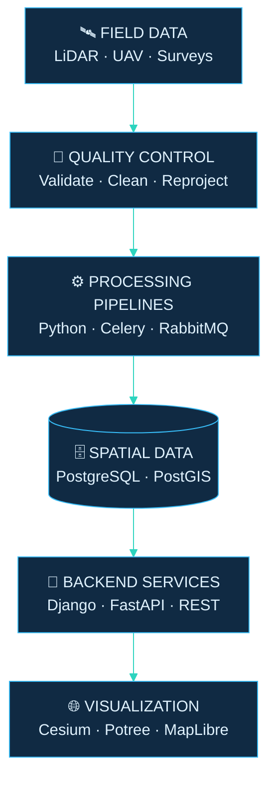

 

 

 

**Turning complex spatial data into dependable software.**

*Python backend engineering · Geospatial data systems · 3D web visualization*

 

  

---

## `01` — The engineer behind the data

I work at the intersection of **geospatial science and software engineering**.

My work spans the full journey of spatial data — from UAV surveys, LiDAR scans and exploration datasets to validated processing pipelines, spatial databases, production APIs and interactive 3D experiences.

I bring a backend engineer’s focus on reliability and automation to the geospatial world, where coordinate systems, data quality and geometric accuracy matter just as much as the code.

<table>
<tr>
<td width="33%" align="center">

**01 / CAPTURE**

 

🛰️

 

Survey & spatial data

</td>
<td width="33%" align="center">

**02 / PROCESS**

 

⚙️

 

Automated pipelines & QA/QC

</td>
<td width="33%" align="center">

**03 / DELIVER**

 

🌐

 

APIs, maps & 3D systems

</td>
</tr>
</table>

> My engineering philosophy: automate the repetitive, validate the critical, and make complex systems dependable.

## `02` — The systems I build

<table>
<tr>
<td width="50%" valign="top">

### 🛰️ Geospatial engineering

- LiDAR and point-cloud processing
- Hyperspectral and magnetic survey data
- UAV, GNSS and laser-scanner workflows
- Coordinate reference systems and transformations
- Spatial QA/QC and delivery automation

</td>
<td width="50%" valign="top">

### ⚙️ Backend engineering

- Django REST Framework and FastAPI
- Asynchronous jobs with Celery and RabbitMQ
- PostgreSQL, PostGIS and spatial data models
- Docker-based services and cloud migrations
- Data processing and reporting APIs

</td>
</tr>
<tr>
<td colspan="2" valign="top">

### 🌍 Geospatial visualization

Interactive mapping and browser-based 3D visualization with **CesiumJS, Potree.js, Three.js, MapLibre and deck.gl** — connecting survey and engineering data with usable web experiences.

</td>
</tr>
</table>

## `03` — From raw data to production

One connected workflow: from raw measurements to validated, accessible spatial intelligence.

## `04` — My technical stack

**LANGUAGES & BACKEND**

  

**DATA, MESSAGING & INFRASTRUCTURE**

  

**FRONTEND & 3D VISUALIZATION**

  

**MACHINE LEARNING & COMPUTER VISION**

  

**GEOSPATIAL & SCIENTIFIC COMPUTING**

 

 

## `05` — Selected engineering work

<table>
<tr>
<td width="50%" valign="top">

### 🧬 Geospatial automation

**The challenge:** Repetitive processing and inconsistent source data.

**The approach:** Python-driven processing workflows, structured validation and QA/QC to turn raw spatial datasets into analysis-ready outputs.

 

`Python` `GIS` `Automation` `QA/QC`

</td>
<td width="50%" valign="top">

### 📊 Spatial assessment & reporting

**The challenge:** Making complex geospatial information usable for analysis.

**The approach:** Backend services and spatial logic that support structured data outputs, assessments and reporting workflows.

 

`Django` `PostGIS` `REST APIs`

</td>
</tr>
<tr>
<td colspan="2" valign="top">

### 🧊 DXF → Potree.js

**Bridging engineering geometry and browser-based 3D visualization.**

Working across CAD and spatial formats to bring engineering data into an interactive web-based point-cloud viewing workflow.

 

`DXF` `JavaScript` `Potree.js` `3D Visualization`

</td>
</tr>
</table>

## `06` — The journey so far

<table>
<tr>
<td width="26%" valign="top">

**2025 — 2026**

 

🛰️ **Geospatial Data Specialist**

</td>
<td valign="top">

**Rosor Explorations**

LiDAR, hyperspectral and magnetic survey workflows across international exploration projects. Spatial QA/QC, processing automation and mentoring.

</td>
</tr>
<tr>
<td width="26%" valign="top">

**2023 — 2024**

 

📐 **GIS Specialist**

</td>
<td valign="top">

**Geo-Kom**

Hands-on surveying with GNSS, total stations, UAVs and laser scanners — connecting field acquisition with dependable spatial data.

</td>
</tr>
<tr>
<td width="26%" valign="top">

**2020 — 2022**

 

💻 **Full Stack / GIS Developer**

</td>
<td valign="top">

**TaQadam**

Django REST Framework services, Celery and RabbitMQ workers, hybrid architecture evolution, and cloud migration from AWS to GCP.

</td>
</tr>
</table>

## `07` — GitHub activity

  

## `08` — Currently exploring

| Focus | Direction |
|:--|:--|
| 🧠 Machine learning | PyTorch, TensorFlow and computer vision |
| ☁️ Point-cloud processing | Open3D, PCL and large-scale 3D data |
| 🗺️ Spatial databases | PostGIS and spatial query optimization |
| 🌐 Web visualization | Interactive maps and browser-based 3D |

Learning includes PostGIS (BTK Academy) and PyTorch / TensorFlow (OpenCV University).

---

## Have a spatial challenge worth solving?

**From point-cloud processing to production geospatial APIs — let's build something reliable.**

 

  

