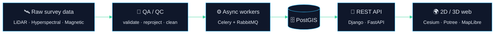

<div align="center">


<a href="https://git.io/typing-svg">
  
</a>

<br/>


<br/><br/>


</div>

<br/>

## 👋 &nbsp;Hey, I'm Sonny

I build the **bridge between the field and the backend**: the part where drone flights, laser scans and survey lines become clean, validated, queryable data that apps can actually use.

I started on the software side (APIs, queues, cloud migrations), then spent years on the geospatial side (LiDAR, UAVs, scanners, mineral-exploration surveys). Today I work where the two meet.

```python
class SonnyHope:
    role      = "Python Backend & Geospatial Engineer"
    superpower = "Speaking both GIS and software engineering"
    works_with = ["LiDAR", "hyperspectral", "magnetic surveys", "photogrammetry"]
    believes_in = ["automation over repetition", "QA/QC before delivery", "boring, reliable pipelines"]

    def currently(self):
        return {
            "building":  "geospatial pipelines & 3D web viewers",
            "exploring": "deep learning for spatial data (PyTorch / TensorFlow)",
            "sharpening": "Open3D, PCL, point-cloud processing at scale",
        }

    def ask_me_about(self):
        return ["CRS pitfalls", "point clouds", "Celery workers that don't fall over", "PostGIS queries"]
```

<br/>

## 🧭 &nbsp;How I think about geospatial systems



<br/>

## 🛠️ &nbsp;What I do

<table>
<tr>
<td width="33%" valign="top">

### 🛰️ Geospatial
Processing and QA of LiDAR, hyperspectral and magnetic survey data across international exploration projects. UAV, GNSS, total station and laser-scanner capture. Reliable CRS handling and geometric transformations.

</td>
<td width="33%" valign="top">

### ⚙️ Backend
REST APIs with Django REST Framework and FastAPI. Heavy compute pushed to **Celery + RabbitMQ** workers. Spatial data modelled in **PostgreSQL / PostGIS**. Containerised with Docker.

</td>
<td width="33%" valign="top">

### 🌍 3D & Web
Interactive maps and 3D scenes in the browser with CesiumJS, Potree.js, Three.js, MapLibre and deck.gl. Bringing CAD and survey formats into the web.

</td>
</tr>
</table>

<br/>

## 🧰 &nbsp;Toolbox

<div align="center">

**Languages & Backend**<br/>


**Data, Messaging & Infra**<br/>


**Frontend & Visualization**<br/>


**ML**<br/>


**Geospatial stack**<br/>


</div>

<br/>

## 🚀 &nbsp;Featured work

<table>
<tr>
<td width="33%" valign="top">

#### 🧬 End-to-End Geospatial Pipeline
Source datasets in, validated analysis-ready outputs out. Automated the repetitive steps and built QC into the flow.

`Python` `GIS` `Automation`

</td>
<td width="33%" valign="top">

#### 📊 Assessment & Reporting Platform
Backend and spatial logic that turns geospatial data into structured outputs for analysis and reporting.

`Python` `GIS` `Backend`

</td>
<td width="33%" valign="top">

#### 🧊 DXF → Potree.js
Bringing CAD geometry into a browser-based 3D point-cloud viewer, bridging engineering and spatial formats.

`Potree.js` `JavaScript` `3D`

</td>
</tr>
</table>

<br/>

## 🧗 &nbsp;Trajectory

| | Chapter | What it taught me |
|:-:|:--|:--|
| 🛰️ | **Geospatial Data Specialist** · Rosor Explorations<br/><sub>2025 – 2026</sub> | Survey data at scale: LiDAR, hyperspectral and magnetic flight lines across international projects. QA/QC, automation, mentoring trainees. |
| 📐 | **GIS Specialist** · Geo-Kom<br/><sub>2023 – 2024</sub> | The physical side: total stations, GNSS, scanners, UAVs. Data is only as good as how it was captured. |
| 💻 | **Full Stack / GIS Developer** · TaQadam<br/><sub>2020 – 2022</sub> | Production backends: DRF services, Celery + RabbitMQ workers, a monolith-to-hybrid shift and an AWS → GCP migration. |

<br/>

## 📈 &nbsp;GitHub, by the numbers

<div align="center">


</div>

<br/>

## 🎓 &nbsp;Always learning

`PostGIS` (BTK Academy) &nbsp;·&nbsp; `PyTorch` (OpenCV University) &nbsp;·&nbsp; `TensorFlow / Keras` (OpenCV University)

<br/>

<div align="center">

### 💬 Got messy spatial data or a geospatial backend to build? Let's talk.


</div>
